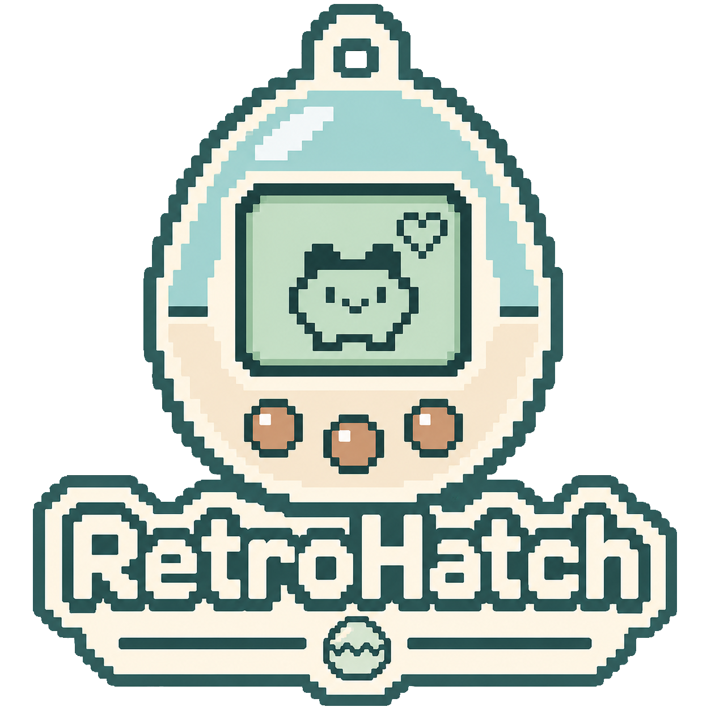

<!-- SPDX-License-Identifier: GPL-3.0-only -->
<!-- SPDX-FileCopyrightText: 2026 Noctyros -->

<p align="center">
  
</p>

# RetroHatch

RetroHatch is a Windows-focused Tamagotchi emulator written in Rust, with a
minimal native egui interface and a deterministic E0C6200 CPU/MCU core. Its goal
is accurate, approachable emulation and a maintainable foundation for community
contributions, without decorative device shells.

**Project status:** RetroHatch is a public open-source project maintained by
Finn Lülsdorf (**Noctyros**) at [noctyros-de/RetroHatch](https://github.com/noctyros-de/RetroHatch).
This README describes current source; downloadable builds may lag behind it.
See [third-party notices](THIRD_PARTY_NOTICES.md) for component credits and licenses.

<!-- BEGIN USER-MANAGED SCREENSHOT GALLERY: preserve entries, order and captions -->
## Screenshots

Selected screenshots will be added here by the project owner.
<!-- Add approved relative images from docs/screenshots/ only.
See docs/screenshots/README.md for copy-and-paste examples. -->
<!-- END USER-MANAGED SCREENSHOT GALLERY -->

<!-- BEGIN USER-MANAGED GAMEPLAY VIDEOS: preserve links, order and captions -->
<details>
<summary>Gameplay Videos</summary>

### Gameplay Videos

Gameplay links will be added here when available.
<!-- Optional linked thumbnails: see docs/screenshots/README.md. -->
</details>
<!-- END USER-MANAGED GAMEPLAY VIDEOS -->

## Installation

1. Open [GitHub Releases](https://github.com/noctyros-de/RetroHatch/releases).
2. Download **`RetroHatch-v<version>-Windows.zip`** when available. Older
   releases may provide **`RetroHatch.exe`** directly instead.
3. If you download a ZIP, extract the entire archive.
4. Double-click **`RetroHatch.exe`**.

**No Rust or Visual Studio installation is required.** The portable package
targets 64-bit Windows 10/11 with an OpenGL 3.3-capable graphics driver. Keep the
included license and attribution files with the executable. ROMs are not
included; import firmware that you have the appropriate rights to use after
starting the application. Settings, imported ROMs and saves are stored in your
Windows user-data directory, outside the extracted application folder.

## Supported devices

| Device | Implementation and validation scope |
| --- | --- |
| Tamagotchi P1 | Japanese user-provided firmware boot, input and gameplay; shared complete saves |
| Tamagotchi Connection V3 (EU hardware) | Native SPLB32; local setup, hatching, care, audio, EEPROM and save/resume validated; ten original replacement symbols; IR unavailable |
| Tamagotchi Tama-Go (Experimental) | Native Generalplus/6502, 48?31 grayscale LCD, audio, full saves and virtual figure slot; focused gameplay and figure tests, with limits below |
| Tamagotchi P2 | Boot, hatching, buttons/LCD/audio, reference comparison, timing and complete saves |
| Tamagotchi Genjintch | Dedicated LCD, buttons and tap sensor; local firmware/reference validation |
| Tamagotchi Angel (Angelgotchi) | Dedicated LCD, buttons and tap sensor; local firmware/reference validation |
| Tamagotchi Morino | Dedicated LCD, buttons and sensor; local firmware/reference validation |
| Tamagotchi Umino (Ocean) | Dedicated LCD, buttons and tap sensor; local firmware/reference validation |
| Tamagotchi Yasashii | Local firmware boot and hatching; original matrix mapping, eight care/select/cancel inputs, six GPIO indicators, audio, real-time pacing and full save/resume validated |
| Tamagotchi Plus Color | Three distinct local 4-MiB images: boot, hatching, menus, buttons, audio, standby/RTC, real-time pacing and full saves validated |
| Tamagotchi Plus Color Hexagontchi | Dedicated profile on the shared S1C33 core; local firmware boot, hatching, distinctive LCD/content, buttons, audio and full saves validated |
| Tamagotchi 4U+ | Japanese local 8-MiB firmware: native boot, hatching, menus, LCD/input/PCM, RTC/standby and full saves validated; NFC connections/DLC unavailable |
| Tamagotchi 4U+ (English) | Locally verified translated image on the shared 4U+ board; English menus confirmed, some Japanese input labels remain; independent saves |
| Tamagotchi iD | Original Japanese October 2009 4-MiB firmware: native S1C33, color LCD, input, audio and save/resume validated; unidentified 8-MiB images are not verified as iD |
| Tamagotchi iD Lovely Melody | Dedicated 4-MiB profile; local firmware boot, heart-themed LCD, inputs, PCM, sleep/wake and full saves validated |
| Tamagotchi iD L | Japanese firmware: boot, LCD, menus, inputs, PCM and full saves validated; one exact verified archive import is accepted |
| Tamagotchi iD L English | English firmware: boot, LCD, inputs, PCM and full saves validated; one exact verified short dump is accepted |
| Tamagotchi iD L Princess Spacy | Dedicated identity on the shared iD-L board; local boot, themed LCD, input, PCM and saves validated |
| Tamagotchi iD L 15th Anniversary | Dedicated identity on the shared iD-L board; local boot, themed LCD/setup, input, PCM, flash initialization and saves validated |
| Tamagotchi P's | Native S1C33; local firmware boot, color LCD, buttons, audio and full-state resume/reference validation; infrared/DLC unavailable |
| Tamagotchi On / Meets | Integrated MIT TG18 ARM backend; working use reported by the project owner. Color LCD, buttons, audio and saves are connected; individual regional editions are not all independently tested. Bluetooth/infrared unavailable |
| Tamagotchi Meets Fairy | Japanese v030 firmware: boot, hatching, LCD, A/B/C, Windows audio, real-time pacing, standby/wakeup and full saves individually validated |
| Tamagotchi Meets Magical | Japanese v031 firmware: boot, hatching, LCD, A/B/C, Windows audio, real-time pacing, standby/wakeup and full saves individually validated |
| Tamagotchi Meets Fantasy | Japanese v047 firmware: boot, hatching, LCD, A/B/C, Windows audio, real-time pacing, standby/wakeup and full saves individually validated |
| Tamagotchi Meets Pastel | Japanese v055 firmware: boot, hatching, LCD, A/B/C, Windows audio, real-time pacing, standby/wakeup and full saves individually validated |
| Tamagotchi Meets Sanrio | Japanese v056 firmware: boot, hatching, LCD, A/B/C, Windows audio, real-time pacing, standby/wakeup and full saves individually validated |
| Tamagotchi Meets Sweets | Japanese v062 firmware: boot, hatching, LCD, A/B/C, Windows audio, real-time pacing, standby/wakeup and full saves individually validated |

Verification covers the available local images and focused gameplay sequences,
not every regional revision, minigame or complete device lifetime. Yasashii uses
its original eight controls, not a tap sensor: Left/Z selects, Down/X cancels,
and 1-6 or Q/W/E/A/S/D operate the six care keys. See
[device validation](developer/YASASHII_AND_TAMAOTCH.md). TamaOtch is
a recognized **unsupported research target**: its exact LCD mapping, geometry
and board settings are unresolved. Recognized TamaOtch firmware is refused with
an explanation; another device's display is not substituted. Connection V3 now
has an **experimental** native SPLB32 profile: real ROM boot, matrix display,
inputs, audio, valid setup, hatching, basic care and state continuation are tested.
All ten symbols now have original, editable GPL replacement drawings; authentic
Bandai-style silhouettes are not distributed by this integration. Validation covers focused offline gameplay, not every minigame or complete lifetime. See [Connection V3 status](developer/CONNECTION_V3.md).
Other Connection generations are unavailable.
The [native S1C33 backend](developer/S1C33.md) now runs the locally verified
Tamagotchi P's, Plus Color/Hexagontchi, 4U+, original iD, Lovely Melody and the listed iD L editions with the
shared library, 128x128 color display, controls, audio, slots and autosave. See the
[iD and iD L validation scope](developer/ID_FAMILY.md) and
[Plus Color validation scope](developer/PLUS_COLOR.md) and [4U+ validation](developer/4UPLUS.md).
Original 4U (without the plus) remains an internal
configuration, unavailable as a supported profile. The unidentified
8-MiB file named as February 2010 iD runs with the iD-L board, but is not
fingerprinted as any model: import requires explicit compatible model selection.
Infrared, DLC and upstream `.sav`/`.tamasave` import are not implemented.

On/Meets is available through the same ROM library and interface. Its operating
status combines implemented/tested host integration with the project owner's
reported working use. This documentation audit did not repeat a firmware boot
or verify every On/Meets variant. See [TG18 integration](developer/TG18.md).

### Experimental Tama-Go

Tama-Go runs through the existing interface with a native Generalplus/6502
backend, 48?31 four-level matrix, A/B/C, audio, slots and autosave.
**Emulation > Tama-Go Figure** imports accessories, selects stored figures and
removes the current figure without resetting progress. Twelve regular figures
and two full captures have firmware SPI/content tests. The debug image is an
accessory; its diagnostic mode is not verified. Fixed-symbol states use host
text labels, not original LCD silhouettes. Complete minigame/shop coverage,
long-term progression, IR and TamaTown connectivity remain unavailable or
unverified. See [Tama-Go validation](developer/TAMAGO.md).

## Build from source

These instructions are for developers. Downloaded Windows release packages do
not require a Rust toolchain or Visual Studio.

1. Install Rust 1.99.1 with rustup and the `x86_64-pc-windows-msvc` target.
2. Install Visual Studio Build Tools with **Desktop development with C++** and
   a Windows SDK.
3. Open PowerShell in a writable source checkout:

```powershell
cd app
cargo build --release --locked
./target/release/RetroHatch.exe
```

Use an optimized build for gameplay. For a distribution candidate, run
`powershell -NoProfile -ExecutionPolicy Bypass -File app/tools/build_release.ps1`
from the repository root instead. This runs the same locked release build with
build-path privacy remapping and a statically linked C runtime. The
[release guide](developer/RELEASE.md) explains packaging and tag automation.

No ROM, private reference checkout or private documentation is needed to
compile. Cargo downloads locked dependencies on the first online build. The
matching source ZIP attached to a release also includes vendored dependencies
for offline Cargo builds. Native Windows dialogs and audio are the supported
host integrations; other operating systems are not validated release targets.
See [CONTRIBUTING.md](CONTRIBUTING.md) for checks.

## Import your own firmware

Choose **File > Import ROM...**. RetroHatch validates the image against its
hardware profile and computes SHA-256. A verified known hash identifies
its device; genuinely ambiguous content asks for the model once and remembers
that association locally. Filenames do not establish identity or region.

The application copies the image into its private local library without moving
or deleting the original. **My Tamagotchis** starts imported devices with one
click. **Manage ROMs...** edits associations and repairs/removes internal
copies; removal never deletes original ROMs or saved games. Identical imports
share content storage. P1/P2 expect 12,288-byte unpacked images; the four
supported sensor-equipped profiles expect 16,384 bytes. Size alone does not
prove that a model is supported. Classic images use unpacked big-endian 12-bit
words; packed classic dumps are not accepted. P's uses its dedicated 8-MiB
S1C33 flash-image validation, separate from classic and On/Meets formats.
Original iD, Lovely Melody and Plus Color/Hexagontchi use distinct 4-MiB profiles; iD L editions use an
8-MiB NOR map. Only the exact tested Japanese archive/member and English short
image have a bounded compatibility adapter matching tamaemu's zero-filled
loader. Other archives or incomplete dumps are rejected. Original imports and
hash identities are preserved; see [import evidence](developer/ID_FAMILY.md).

On/Meets imports require an exact 8-MiB flash image beginning with `SPII`.
Nine upstream code fingerprints supply revision labels for known On (EN) and
Meets (JP) images; these are FNV-1a code fingerprints, not invented full-ROM
SHA-256 entries. Full-dump SHA-256 still isolates every local library entry and
save. An unknown TG18-shaped image asks for confirmation once. Filenames never
prove a variant; SOME is not supported. On/Meets validation scope is described above.

## Controls and settings

| Action | Control |
| --- | --- |
| A / B / C | Left / Down / Right Arrow; also A/B/C or 1/2/3 and on-screen buttons |
| Tap / Knock | Up Arrow, Tap button or LCD click, only on supported sensor devices |
| Pause / Resume | Space or the Emulation menu |
| Reset | F5 or the Emulation menu, with confirmation |
| View all shortcuts | Help > Keyboard Shortcuts |

Settings preserves five pastel themes, button-label visibility, mute/volume,
autosave and exit-save preferences. Green is the new-installation default.
Diagnostics are optional and hidden by default. Emulation continues without
window focus and while minimized, unless explicitly paused. Closing the app
stops emulation; it does not simulate offline growth while closed.

## Save states and local privacy

File provides Save Now, three manual slots, slot loading and save import/export.
Full states include CPU, memory, peripheral/timer/interrupt/oscillator state,
audio generation and emulated time. ROM SHA-256 and device profile separate
save identities, including P1 versus P2. Integrity/version/identity checks reject
incompatible states. Autosave is separate from manual slots; options are Off,
1, 5, 10, 15 or 30 minutes. Save on Exit is independently enabled by default.

Normal Windows data lives under `%LOCALAPPDATA%\RetroHatch`: configuration,
`rom-library`, and per-ROM/device `saves`. Compatible autosaved progress resumes
on reopening. `RETROHATCH_DATA_DIR` is a deliberate development override; keep
it outside a source checkout. The emulator has no implemented cloud sync or
ROM upload service. Treat saved states, library metadata and diagnostics as
private. See [privacy and architecture](developer/ARCHITECTURE.md).

## Contribute

Read [CONTRIBUTING.md](CONTRIBUTING.md), use English, and submit small changes
with reproducible tests and hardware/provenance evidence. Issues and pull
requests are welcome in the public repository; the maintainer reviews changes
and controls merges. Preserve the owner-managed media gallery.

## License and credits

Original RetroHatch contributions are Copyright (C) 2026 Finn L?lsdorf / Noctyros
and licensed under **GPL-3.0-only**. See [LICENSE](LICENSE) and
[COPYRIGHT.md](COPYRIGHT.md).

Thanks to **azya52** (BrickEmuPy), **oreo-fox** (TG18-Emu), **maragotchi**
(tamaemu), **Bryon Vandiver / asterick** (tamago), and **mameise**
(T7Emu / Paramix Studio). Component scope, original notices and license texts
are collected in [THIRD_PARTY_NOTICES.md](THIRD_PARTY_NOTICES.md).

RetroHatch is an unofficial fan project. It is not affiliated with, endorsed
by, or sponsored by Bandai. Tamagotchi and related names belong to their
respective owners. Copyrighted ROMs and firmware are **not included**; users
must obtain appropriate rights to use their own images. Do not request or
submit firmware downloads, dumps or private saves.

## Capture tools and optional local branding

The **Screenshots** menu provides **Take LCD Screenshot (F8)** and
**Take Emulator Screenshot (F9)**, plus folder shortcuts. LCD PNGs retain native
content (classic segment bounds 352×329; color framebuffer 128×128). Emulator
PNGs include the visible Windows frame, menus and controls without other desktop
content. Older AppData screenshots are left untouched.

Captures use the actual Windows Pictures known folder, including redirected or
OneDrive folders: `Pictures/RetroHatch/Screenshots/LCD/` and `Screenshots/Emulator/`.
Recordings use `Pictures/RetroHatch/Recordings/LCD/` and `Recordings/Emulator/`.
Names include the model and UTC timestamp and never replace existing files.

**Settings → Display Scale** offers 33%, 50%, 75%, 100%, 150%, 200% and 300%.
100% is the normal responsive display; only the LCD scales, with fixed-size
controls and scrolling when needed. Color pixels use nearest-neighbor sampling.
The setting persists; F8 always remains native-size.

Use **Start Emulator Recording (F10)** or **Start LCD Recording** in Screenshots.
F10 or **Stop Recording** finishes the MP4. Windows Media Foundation encodes
H.264 at 30 FPS on a background thread; no external encoder installation is
required. **Recording is currently video-only: game audio is not included.**
The fixed footer shows recording time and temporary confirmations. Hover a
confirmation for the saved path and details.
See [capture details and limitations](developer/CAPTURE_MEDIA.md).

The README logo is the owner-supplied public copy at `docs/assets/retrohatchlogo.png`.
Private originals stay outside the repository in `../local/resources/`. To brand
a local Windows build, place `retrohatchicon.ico` there or set
`RETROHATCH_RESOURCES_DIR` to its directory, then build normally. The build embeds that ICO in
the EXE and uses its PNG frame for title-bar/taskbar/window icons. The supplied
ICO currently contains a 256×256 frame, scaled by Windows. Clean public checkouts
without private resources build with standard Windows/eframe fallback icons. Set
`$env:RETROHATCH_UNBRANDED='1'` before Cargo to explicitly select that fallback.
See [branding and capture implementation](developer/BRANDING_SCREENSHOTS.md)
and [optional development workspace setup](developer/WORKSPACE.md).
